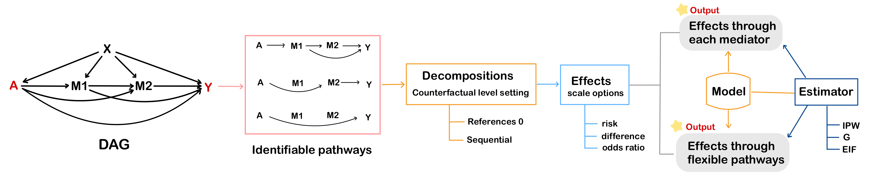
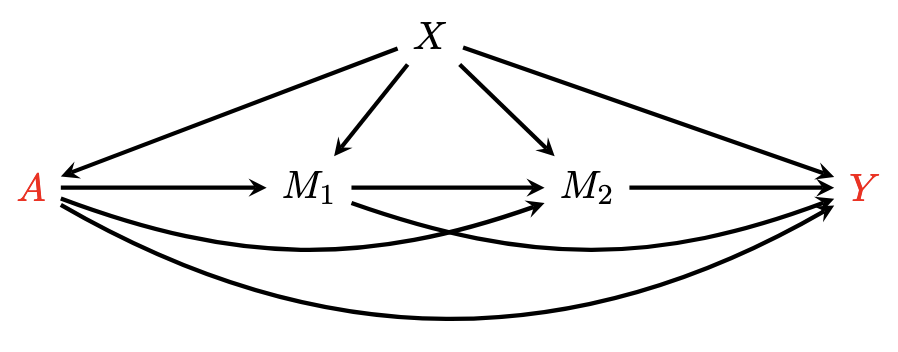
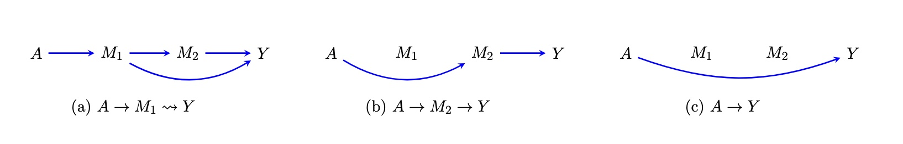
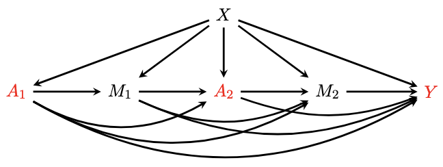
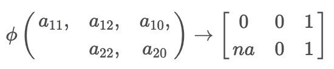

flexPaths: An R Package for Causal Path-Specific Effect Estimation with
Flexible Settings
================
Xiaxian Ou
2026-11-03

- [0. Installation:](#0-installation)
- [1. Quick example: Single
  Treatment](#1-quick-example-single-treatment)
  - [1.1 `pathsEffect`: PSEs through each
    mediator](#11-pathseffect-pses-through-each-mediator)
  - [1.2 `flexEffect`: PSE for flexible
    pathway(s)](#12-flexeffect-pse-for-flexible-pathways)
- [2. Quick example: Multiple
  Treatments](#2-quick-example-multiple-treatments)
  - [2.1 `flexEffect`: PSE for flexible
    pathway(s)](#21-flexeffect-pse-for-flexible-pathways)
- [3. Further instructions for flexible
  models](#3-further-instructions-for-flexible-models)
  - [3.1 Examples for model
    specification](#31-examples-for-model-specification)
  - [3.2 Summary for models and the required
    arguments](#32-summary-for-models-and-the-required-arguments)

flexPaths estimates identifiable **path-specific means and effects** in
longitudinal studies with multiple causally ordered mediators and either
a single binary treatment or repeated binary treatments. It provides
inverse probability weighting, plug-in g-computation, and
influence-function-based estimators. The implementation uses sequential
outcome regressions to replace integrations and Bayes’ rule to express
mediator-density ratios through treatment-history probabilities,
avoiding direct mediator-density estimation.

The input data must be in **wide format**, with one row per individual.
Treatments and mediators measured at different times are stored in
separate columns. At least one baseline covariate must be supplied
through `cov_x`.

If you find this package useful, please cite [this
paper](https://arxiv.org/abs/2610.34349):

``` bibtex
@article{ou2026causalpse,
  title   = {Inference for Causal Path-Specific Effects in Longitudinal Studies with Repeated Treatments and Multiple Mediators},
  author  = {Ou, Xiaxian and He, Xinwei and Nabi, Razieh},
  journal = {arXiv preprint arXiv:2610.34349},
  year    = {2026}
}
```

This is a schematic illustration of the flexPaths workflow:



Primary advantages of the package include:

- **Flexible model size**: The number of treatment(s) and mediator(s) is
  flexible.

- **Flexible decomposition**: This package can return the Natural PSEs
  and Cumulative PSEs via each mediator.

- **Flexible pathways**: Users can estimate path-specific counterfactual
  means for identified treatment assignments and effects by comparing
  these means.

- **Flexible models**: The package supports model fitting using
  `glm/lm`, `bart` in package `dbarts`, and `SuperLearner` in package
  `SuperLearner`. Users can also integrate new models using the template
  in `inst/templates/fl_model_template.R`.

- **Flexible estimators**: Choose inverse probability weighting
  (`"IPW"`), plug-in g-computation (`"G"`), or efficient influence
  function-based estimation (`"EIF"`).

Usage instructions and examples are provided below. `pathsInfo()`
provides the analysis settings and model specifications used by the mean
and effect estimation functions.

`pathsInfo()` accepts each treatment column as numeric 0/1 or as a
factor with exactly two non-missing levels. It maps the first factor
level to 0 and the second to 1, respecting the order in `levels()`
(including ordered factors). Set the factor levels before calling
`pathsInfo()` to choose the reference level. Its returned `$data`
contains numeric 0/1 treatment columns; use these codes for `assign` in
subsequent analyses. Rows containing missing values are dropped; the
original input data frame is not modified.

Direct standard errors are returned only for EIF potential means. For
effects, direct standard errors, confidence intervals and p-values are
returned only with EIF estimation and `scale = "diff"`; other results
contain point estimates without these columns. Set `nboot` in
`flexEffect()` or `pathsEffect()` for bootstrap standard errors and
confidence intervals with any estimation method or scale. Bootstrap
p-values are available only for `scale = "diff"`. Set `nboot` in
`flexMean()` or `mflexMean()` for bootstrap mean standard errors. Their
`$boot_results` contain the original mean and `boot.SE`, calculated by
resampling individuals and refitting the models in each bootstrap
sample. For G and IPW estimation, `pathsInfo()` displays a message
recommending bootstrapping for standard errors. The `$potential_data`
field of `flexMean()` and `mflexMean()` contains observation-level
contributions to the mean estimator.

# 0. Installation:

``` r
install.packages("devtools")

devtools::install_github("xxou/flexPaths")
library(flexPaths)
```

# 1. Quick example: Single Treatment

Here, we illustrate the case with two mediators $M_1$ and $M_2$ (the
mediator can be high dimensional). Let $A$ denote the binary treatment
(0 or 1), $Y$ denote the outcome, and $X$ denote the covariates.



Denote the counterfactual outcome
$\phi(a_1, a_2, a) = Y(a,M_1(a_1),M_2(a_2,M_1(a_1)))$ that would be
observed if $A$ were set to $a$ and $M_1$ and $M_2$ were set to the
natural value they would have taken if $A$ had been $a_1$ and $a_2$,
where $(a_1, a_2, a) \in \{0,1\}^3$.

**Identified pathways**:

In the case of two mediators, we have three identified pathways. Using
`pathsEffect`, we can obtain the effect via each mediator.



**Decomposition**:

`decomposition = "refer0"`: The effect of specific pathway can be
defined as a contrast against $Y(0)$ on a mean scale, and these effects
are also called natural path-specific effect:

- $\rho_{A \rightarrow M_1 \leadsto Y} = \mathbb{E} (\phi(1,0,0)) - \mathbb{E} (\phi(0,0,0))$
- $\rho_{A \rightarrow M_2 \rightarrow Y} = \mathbb{E} (\phi(0,1,0)) - \mathbb{E} (\phi(0,0,0))$
- $\rho_{A \rightarrow Y} = \mathbb{E} (\phi(0,0,1)) - \mathbb{E} (\phi(0,0,0))$

`decomposition = "sequential"`: Decompose the total effect into
cumulative path-specific effects:
$\mathbb{E}(Y(1)) - \mathbb{E}(Y(0)) =\rho_{A \rightarrow M_1 \leadsto Y} + \rho_{A \rightarrow M_2 \rightarrow Y} + \rho_{A \rightarrow Y}$.

- $\rho_{A \rightarrow M_1 \leadsto Y} = \mathbb{E} (\phi(1,1,1)) - \mathbb{E} (\phi(0,1,1))$
- $\rho_{A \rightarrow M_2 \rightarrow Y} = \mathbb{E} (\phi(0,1,1)) - \mathbb{E} (\phi(0,0,1))$
- $\rho_{A \rightarrow Y} = \mathbb{E} (\phi(0,0,1)) - \mathbb{E} (\phi(0,0,0))$

Natural and cumulative PSEs use different contrasts and need not agree.
On the difference scale, the cumulative PSEs sum to the total effect by
construction; the natural PSEs generally do not. Ratios of natural PSEs
to the total effect therefore need not sum to one.

**Models for Estimation**:

- IPW uses conditional treatment probabilities
  $P(A|X), P(A|X,M_1), \ldots, P(A|X,M_1,\ldots,M_K)$, specified through
  `model.treatment`.
- Plug-in g-computation uses outcome regressions
  $\mathbb{E}(Y|A,X), \mathbb{E}(Y|A,X,M_1), \ldots, \mathbb{E}(Y|A,X,M_1,\ldots,M_K)$
  and sequential regressions, specified through `model.outcome` and
  `model.iter`.
- EIF uses both treatment and outcome regressions, together with the
  sequential regressions.

These predictor sets describe the single-treatment setting with $K$
mediator stages. We recommend a common model specification within each
argument, such as `SuperLearner` with an appropriate family and
candidate learner library. Section 3 explains the optional settings for
individual regressions.

## 1.1 `pathsEffect`: PSEs through each mediator

``` r
data("singTreat")
head(singTreat)
##   Treat          X1          X2       Med1     Med2_1     Med2_2        Med3
## 1     1 -0.56047565 -0.99579872 -0.2909027  1.4214143  0.9080483 -0.48342238
## 2     0 -0.23017749 -1.03995504  0.5282772 -1.6131178 -0.6618017 -1.85925365
## 3     1  1.55870831 -0.01798024  0.1072271 -1.5679208  2.0982984 -0.53101464
## 4     0  0.07050839 -0.13217513 -0.5198824 -0.4209952 -1.0630016  0.46861537
## 5     1  0.12928774 -2.54934277  1.3002422  0.2256734  1.3468199  0.01871409
## 6     1  1.71506499  1.04057346  0.3673916  0.5568637  2.1457944  2.10776412
##     Outcome1 Outcome2
## 1  1.3885202        1
## 2 -0.7139441        1
## 3  1.8068598        0
## 4  1.0421935        1
## 5 -0.3632091        1
## 6  2.1553060        1

# Use a small subset to keep this demonstration quick.
EIF_fit <- pathsInfo(data = singTreat[1:200, ], A = "Treat", Y = "Outcome1",
                    cov_x = c("X1", "X2"),
                    M.list = list(M1 = "Med1", M2 = c("Med2_1", "Med2_2")),
                    estimation = "EIF",
                    model.outcome = ~SuperLearner(
                      SL.library = c("SL.glm", "SL.mean"), family = gaussian()),
                    model.treatment = ~SuperLearner(
                      SL.library = c("SL.glm", "SL.mean"), family = binomial())
)

# Natural PSEs
results_refer0 <- pathsEffect(pathsInfo = EIF_fit, decomposition = "refer0",
                             scale = "diff", CI_level = 0.95,
                             nboot = NULL, m.cores = NULL)

# Cumulative PSEs
results_seq <- pathsEffect(pathsInfo = EIF_fit, decomposition = "sequential",
                          scale = "diff", CI_level = 0.95,
                          nboot = NULL, m.cores = NULL)

# nboot = NULL uses direct EIF inference on the difference scale.
```

``` r
results_refer0
## 
## Causal Paths Analysis: 0 reference decomposition ; scale: diff ; estimation: EIF
## 
## Call: pathsEffect(pathsInfo = EIF_fit, decomposition = "refer0", scale = "diff", 
##     CI_level = 0.95, nboot = NULL, m.cores = NULL)
## 
## 
## Causal Paths Estimates: 
## 
##                      Path     Effect         SE    CI.lower  CI.upper P.value
## 1           A->M1->...->Y 0.15329311 0.06657314  0.02281215 0.2837741  0.0213
## 2           A->M2->...->Y 0.08525676 0.05450477 -0.02157062 0.1920841  0.1178
## 3                    A->Y 0.59389739 0.12859880  0.34184838 0.8459464  0.0000
## 4 total effect: A->...->Y 0.87585785 0.14867371  0.58446273 1.1672530  0.0000
```

``` r
results_seq
## 
## Causal Paths Analysis: sequential decomposition ; scale: diff ; estimation: EIF
## 
## Call: pathsEffect(pathsInfo = EIF_fit, decomposition = "sequential", 
##     scale = "diff", CI_level = 0.95, nboot = NULL, m.cores = NULL)
## 
## 
## Causal Paths Estimates: 
## 
##                      Path    Effect         SE   CI.lower  CI.upper P.value
## 1           A->M1->...->Y 0.1546925 0.06868172 0.02007878 0.2893062  0.0243
## 2           A->M2->...->Y 0.1323885 0.04988752 0.03461076 0.2301662  0.0080
## 3                    A->Y 0.5869481 0.12991777 0.33231397 0.8415823  0.0000
## 4 total effect: A->...->Y 0.8740291 0.14960460 0.58080947 1.1672487  0.0000
```

## 1.2 `flexEffect`: PSE for flexible pathway(s)

`flexEffect()` estimates effects for identified pathways or combinations
of pathways by comparing objects returned by `flexMean()`.

`flexMean()` estimates a **path-specific counterfactual mean**. The
argument `assign = c(a1, a2, a)` specifies the treatment assignments for
$M_1$, $M_2$, and $Y$, in that order.

Comparing $\mathbb{E} (\phi(1,0,1))$ and $\mathbb{E} (\phi(0,0,0))$
combines the pathways initiated through $M_1$ with the direct pathway
from $A$ to $Y$.

``` r
# assign follows the order (M1, M2, Y).
# c(1, 0, 1) assigns treatment 1 to M1 and Y, and treatment 0 to M2.
potential_outcome0 <- flexMean(pathsInfo = EIF_fit, assign = c(0, 0, 0))
potential_outcome1 <- flexMean(pathsInfo = EIF_fit, assign = c(1, 0, 1))
potential_outcome2 <- flexMean(pathsInfo = EIF_fit, assign = c(1, 1, 0))
potential_outcome3 <- flexMean(pathsInfo = EIF_fit, assign = c(1, 0, 0))

# Ten bootstrap samples illustrate the syntax only; use more for analysis.
set.seed(123)
flex_results <- flexEffect(p1 = potential_outcome1,
                          p0 = potential_outcome0,
                          scale = "diff", CI_level = 0.95,
                          nboot = 10, m.cores = NULL)

flex_results
## 
## Flexible Paths Analysis 
## 
## Call: flexEffect(p1 = potential_outcome1, p0 = potential_outcome0, 
##     scale = "diff", CI_level = 0.95, nboot = 10, m.cores = NULL)
## 
## 
## boot strap results: 
## 
##       assign    Effect   boot.SE boot.CI.lower boot.CI.upper nboot boot.P.value
## 1 101 vs 000 0.7451383 0.1608642     0.5212569      1.046284    10            0
```

For multiple comparisons, `p1` and `p0` can be lists. All objects must
have the same class, either `flexMean` or `mflexMean`, and use the same
analysis settings. Note the following:

1.  When `p1` and `p0` have the same length, comparisons are made
    element by element. Here, `flex_results1` compares
    `potential_outcome1` with `potential_outcome0`, and
    `potential_outcome2` with `potential_outcome3`.

2.  When either input contains a single object, that object is compared
    with each object in the other input. Here, `flex_results2` compares
    `potential_outcome1` with `potential_outcome2` and with
    `potential_outcome3`.

``` r
flex_results1 <- flexEffect(p1 = list(potential_outcome1, potential_outcome2),
                           p0 = list(potential_outcome0, potential_outcome3),
                           scale = "diff", CI_level = 0.95)

flex_results1
## 
## Flexible Paths Analysis 
## 
## Call: flexEffect(p1 = list(potential_outcome1, potential_outcome2), 
##     p0 = list(potential_outcome0, potential_outcome3), scale = "diff", 
##     CI_level = 0.95)
## 
## 
## Causal Paths Estimates: 
## 
##       assign     Effect         SE     CI.lower  CI.upper P.value
## 1 101 vs 000 0.74513826 0.14474743  0.461438519 1.0288380  0.0000
## 2 110 vs 100 0.09724062 0.05215802 -0.004987228 0.1994685  0.0623


flex_results2 <- flexEffect(p1 = list(potential_outcome1),
                           p0 = list(potential_outcome2, potential_outcome3),
                           scale = "diff", CI_level = 0.95)
flex_results2
## 
## Flexible Paths Analysis 
## 
## Call: flexEffect(p1 = list(potential_outcome1), p0 = list(potential_outcome2, 
##     potential_outcome3), scale = "diff", CI_level = 0.95)
## 
## 
## Causal Paths Estimates: 
## 
##       assign    Effect        SE  CI.lower  CI.upper P.value
## 1 101 vs 100 0.5937936 0.1252703 0.3482683 0.8393189   0e+00
## 2 101 vs 110 0.4965530 0.1341881 0.2335491 0.7595569   2e-04
```

# 2. Quick example: Multiple Treatments

The following diagram illustrates two treatments and two mediator
stages, each of which may be multivariate. Let $A_1$ and $A_2$ denote
binary treatments (0 or 1), $Y$ denote the outcome, and $X$ denote the
covariates.



The sequence of treatments and mediators follows the order:
$A_1 \rightarrow M_1 \rightarrow A_2 \rightarrow M_2 \rightarrow Y$.

Denote the counterfactual outcome
$\phi(a_{11}, a_{12}, a_{10}, a_{22}, a_{20} ) = Y(a_{10}, a_{20},M_1(a_{11}),M_2(a_{12}, a_{22},M_1(a_{11})))$,
where $a_{ij}$ represents the counterfactual value of treatment $i$ for
mediator $j$ ($j = 0$ represents outcome $Y$). Notably, since $M_1$
occurs before $A_2$, thus there is no counterfactual value of $A_2$ for
$M_1$, and thus $a_{21}$ is $NA$. Taking the direct effect of treatment
$A_1$ and treatment $A_2$ as an example,
$\phi(a_{11}=0, a_{12}=0, a_{10}=1, a_{22}=0, a_{20}=1 )$ means what the
outcome would be when individuals were treated with both $A_1=1$ and
$A_2=1$ and the mediator $M_1$ was set at its natural level for those
without treatment 1 ($A_1=0$), as well as mediator $M_2$ was set at its
natural level for those without both treatments 1 ($A_1=0$) and
treatment 2 $A_2=0$).

This can be represented in matrix form, where rows represent treatments
and columns represent mediator stages followed by the outcome:



**Models for Estimation**: For repeated treatments, supply one common
model specification within each argument.

- IPW Approach: Users must select a single modeling technique to fit all
  propensity models.
- Plug-in G Computation: Specify `model.outcome` and optionally
  `model.iter` for the sequential regressions.
- EIF Approach: Specify `model.treatment`, `model.outcome`, and
  optionally `model.iter`.

If `model.iter = NULL`, it uses the outcome specification with the
family changed to `gaussian()` when a family argument is present. See
Section 3 for details.

## 2.1 `flexEffect`: PSE for flexible pathway(s)

`flexEffect()` compares objects returned by `mflexMean()` in the same
way as in the single-treatment case.

`mflexMean()` estimates a **path-specific counterfactual mean** for
repeated treatments. Supply `assign` as a list with one numeric vector
per treatment, in the order specified by `pathsInfo$A`. Each vector
contains assignments for the mediator stages followed by the outcome.
Use `NA` for mediator stages that precede that treatment, and 0 or 1
elsewhere.

The runnable example below uses the three-treatment `multiTreat`
dataset, whose ordering is `T1, T2, M1, M2, M3, T3, M4, M5, M6, Y`. It
compares assigning all three treatments to 1 for the outcome, while
retaining reference assignments for the mediators, with the
all-reference assignment.

``` r
data("multiTreat")
head(multiTreat)
##            X T1 T2 T3         M1         M2         M3          M4          M5
## 1  0.5110004  1  1  1  1.9973170  0.6401092  0.4582243 -0.27523814 -0.09387742
## 2  1.8079928  0  1  0  1.1450254  0.8124416  2.1308472  1.64126511  1.37869655
## 3 -1.7026150  0  0  1 -1.1258939  1.1395740  1.2105479  0.40682505  0.67242152
## 4  0.2874488  0  0  1  0.1496110  0.2528034 -1.0118998  0.25536960  0.91400475
## 5 -0.2691142  0  1  0 -0.4372909 -0.9858409  0.0244613  0.53140872  0.35057702
## 6 -0.3795247  0  1  1  0.1966683  0.6989559  1.0743453  0.01092031  1.57590275
##            M6          Y
## 1 -0.07222626  0.8100211
## 2  3.74522822  9.7240020
## 3 -0.77182524 -0.7412953
## 4  0.73485597  0.9291092
## 5 -0.12227943  0.6170001
## 6  0.38646757  2.0241894

mfit <- pathsInfo(data = multiTreat[1:200, ],
                  Y = "Y", A = c("T1", "T2", "T3"), cov_x = "X",
                  M.list = list(M1 = "M1", M2 = "M2", M3 = "M3",
                                M4 = "M4", M5 = "M5", M6 = "M6"),
                  estimation = "EIF",
                  model.treatment = ~SuperLearner(
                    SL.library = c("SL.glm", "SL.mean"), family = binomial()),
                  model.outcome = ~SuperLearner(
                    SL.library = c("SL.glm", "SL.mean"), family = gaussian())
)

# Each vector follows (M1, M2, M3, M4, M5, M6, Y).
# T3 occurs after M3, so its first three entries are NA.
mp1 <- mflexMean(pathsInfo = mfit,
                assign = list(a1 = c(0,  0,  0,  0, 0, 0, 1),
                              a2 = c(0,  0,  0,  0, 0, 0, 1),
                              a3 = c(NA, NA, NA, 0, 0, 0, 1)))
mp2 <- mflexMean(pathsInfo = mfit,
                assign = list(a1 = c(0,  0,  0,  0, 0, 0, 0),
                              a2 = c(0,  0,  0,  0, 0, 0, 0),
                              a3 = c(NA, NA, NA, 0, 0, 0, 0)))
```

Pass `mp1` as `p1` and `mp2` as `p0` to compare the two means. Lists of
objects are supported as in the single-treatment case.

``` r
flexEffect(p1 = mp1, p0 = mp2,
           scale = "diff", CI_level = 0.95)
## 
## Flexible Paths Analysis 
## 
## Call: flexEffect(p1 = mp1, p0 = mp2, scale = "diff", CI_level = 0.95)
## 
## 
## Causal Paths Estimates: 
## 
##                                         assign   Effect        SE CI.lower
## 1 0000001;0000001;0001 vs 0000000;0000000;0000 1.416267 0.1973722 1.029424
##   CI.upper P.value
## 1 1.803109       0
```

# 3. Further instructions for flexible models

For `model.treatment` and `model.outcome`, supply one formula or a list
containing one formula to apply a common specification to all required
regressions. For repeated treatments, use this common specification. For
a single treatment with $K$ mediator stages, you may instead supply
$K+1$ formulas, ordered by the conditioning sets shown in Section 1. The
list may be named `cov_x`, `M1`, …, `MK`.

We recommend a common `SuperLearner` specification within each argument,
with an appropriate family and candidate learner library, to improve
prediction and reduce reliance on a single parametric model. Using one
specification for each argument is simpler than specifying every
regression separately. The detailed settings below are optional.

Supply named fitting arguments as in the underlying fitting function.
flexPaths supplies the training data, response, and predictors. For `lm`
and `glm`, an optional named, two-sided `formula` can specify
interactions or transformations.

## 3.1 Examples for model specification

**Example 1:**

For the outcome models:
`SuperLearner(SL.library = c('SL.randomForest','SL.xgboost'),family = gaussian())`
will be used to fit
$\mathbb{E}(Y|A,X), \mathbb{E}(Y|A,M_1,X), \mathbb{E}(Y|A,M_1,M_2,X)$.

For the propensity models, models are specified in the following order:

- `bart(verbose = FALSE, ndpost = 200)` for $P(A|X)$,
- `glm(family = binomial())` for $P(A|X, M_1)$,
- `SuperLearner(SL.library = c('SL.randomForest','SL.xgboost'), family = binomial())`
  for $P(A|X, M_1, M_2)$,

``` r
EIF_fit <- pathsInfo(data = singTreat, A = "Treat", Y = "Outcome1", cov_x = c("X1", "X2"),
                    M.list = list(M1 = "Med1", M2 = c('Med2_1', 'Med2_2')),
                    estimation = "EIF",
                    model.outcome = ~ SuperLearner(SL.library = c('SL.randomForest','SL.xgboost'),family = gaussian()),
                    model.treatment = list(cov_x = ~ bart(verbose = FALSE, ndpost = 200),
                                            M1 = ~ glm(family = binomial()),
                                            M2 = ~ SuperLearner(SL.library = c('SL.randomForest','SL.xgboost'),family = binomial()))
)
```

**Example 2:**

To specify the formula in a glm model, use the `formula` argument within
the glm function. This allows you to define the relationship between the
outcome and predictor variables clearly.

``` r
EIF_fit <- pathsInfo(data = singTreat, A = "Treat", Y = "Outcome1", cov_x = c("X1", "X2"),
                    M.list = list(M1 = "Med1", M2 = c('Med2_1', 'Med2_2')),
                    estimation = "EIF",
                    model.outcome = list(cov_x = ~ glm(formula = Outcome1 ~Treat+ X1*X2 ,family = gaussian()),
                                            M1 = ~ glm(formula = Outcome1 ~Treat+Med1+X1*X2, family = gaussian()),
                                            M2 = ~ glm(formula = Outcome1 ~Treat+Med1+Med2_1*Med2_2+X1*X2, family = gaussian())),
                    model.treatment = list( ~ bart(verbose = FALSE, ndpost = 200))
)
```

**Example 3:**

`model.iter` specifies the sequential regressions used for G and EIF
estimation. By default, `model.iter = NULL` reuses the corresponding
`model.outcome` specifications, replacing a supplied family argument
with `gaussian()`.

Supply one formula or a list containing one formula for all sequential
regressions. For repeated treatments, use this common specification. We
recommend this common specification to reduce errors in specifying and
ordering separate regression models.

For a single treatment only, a list of $K$ formulas may instead specify
regressions with predictors $(A,X)$, $(A,M_1,X)$, …,
$(A,M_1,\ldots,M_{K-1},X)$, in that order. The following example
specifies two sequential regression models for two mediator stages.

``` r
EIF_fit <- pathsInfo(data = singTreat, A = "Treat", Y = "Outcome1", cov_x = c("X1", "X2"),
                    M.list = list(M1 = "Med1", M2 = c('Med2_1', 'Med2_2')),
                    estimation = "EIF",
                    model.outcome = list( ~ bart(verbose = FALSE, ndpost = 200)),
                    model.treatment = list( ~ bart(verbose = FALSE, ndpost = 200)),
                    model.iter = list(cov_x = ~ glm(formula = Outcome1 ~Treat+X1*X2 ,family = gaussian()),
                                         M1 = ~ glm(formula = Outcome1 ~Treat+Med1+X1*X2, family = gaussian())
                                     )
)
```

**Example 4:**

In **multiple treatment analysis**, use a two-sided formula such as
`formula = Y ~ . + I(X^2)`. The dot includes the predictors supplied for
each regression, and `I(X^2)` adds a quadratic term. The wrapper
replaces the left-hand side with the appropriate response.

``` r
mfit<- pathsInfo(data = multiTreat,
                 Y = "Y",
                 A = c("T1","T2"),
                 cov_x = "X",
                 M.list = list(
                   M1 = 'M1',
                   M2 = 'M2'
                 ),
                 estimation = "EIF",
                 model.treatment =list(~ glm(formula = Y~ . + I(X^2),family = binomial())),
                 model.outcome = list(~ glm(formula = Y~ . + I(X^2),family = gaussian()))
                 
)
```

**Extend model**: The installed template provides a working linear-model
example. Copy it to your analysis directory, adapt the fitting and
prediction code, and rename `fl_template`, `predict.fl_template`, and
the class `"fl_template"` together, for example to `fl_my_model`,
`predict.fl_my_model`, and `"fl_my_model"`. Keep the function arguments
shown in the template. Predictions should return one conditional mean
per row, or the probability of 1 for a binary response.

``` r
file.copy(system.file("templates", "fl_model_template.R",
                      package = "flexPaths", mustWork = TRUE), "my_model.R")
file.edit("my_model.R")
# After adapting and renaming the functions:
source("my_model.R", local = globalenv())
```

Then use `model.outcome = ~my_model()` in `pathsInfo()`, or use it for
`model.treatment` if the model returns probabilities for the binary
treatment. The template is supplied as a file; its functions are loaded
when you source your edited copy.

<br>

## 3.2 Summary for models and the required arguments

Specify models in `pathsInfo()` using expressions such as
`~ glm(family = binomial())` or `~ lm()`. flexPaths supplies the
variables and training data automatically. Use the original function
names without the `fl_` prefix, and name every supplied argument.

| Package | Function | Arguments to specify |
|----|----|----|
| `stats` | `lm` | None required. |
| `stats` | `glm` | An appropriate `family`, such as `binomial()` for binary treatments; default: `gaussian()`. |
| `dbarts` | `bart` | None required. Tuning options such as `ntree` and `ndpost` are optional. |
| `SuperLearner` | `SuperLearner` | `SL.library`, such as `c("SL.glm", "SL.mean")`, and an appropriate `family` (default: `gaussian()`). |

Other model options follow the original fitting functions. For `lm` and
`glm`, a named, two-sided `formula` can optionally specify interactions
or transformations. See `?fl_glm`, `?fl_lm`, `?fl_bart`, or
`?fl_SuperLearner` for the wrapper arguments.
